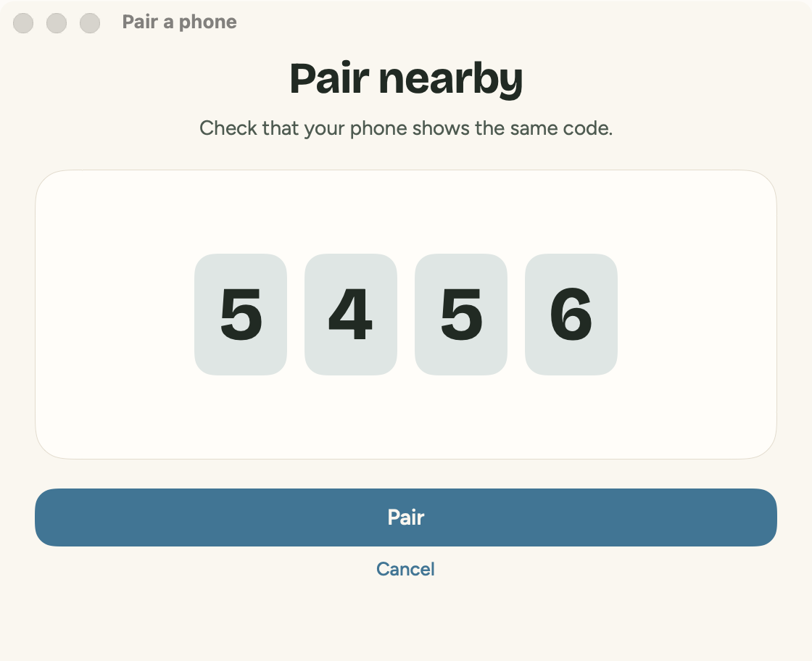
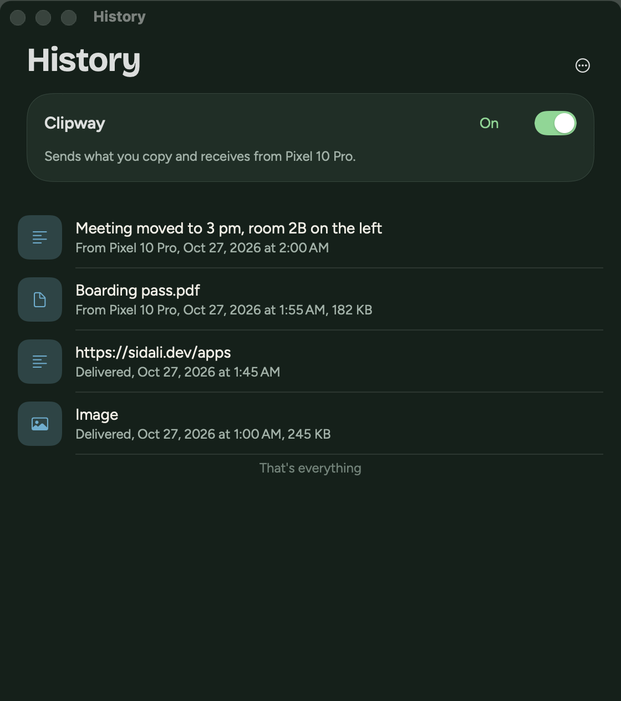
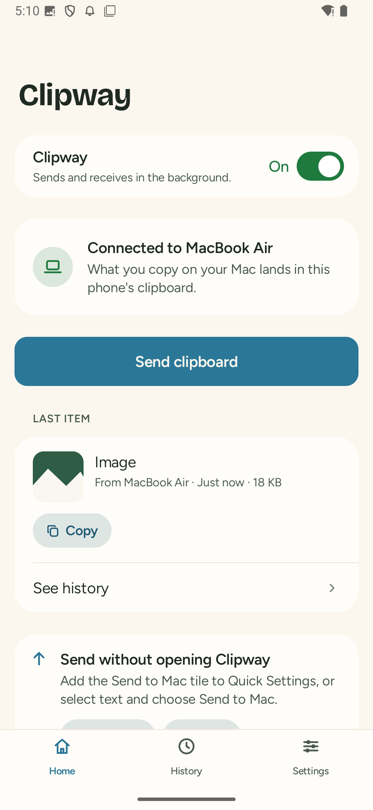
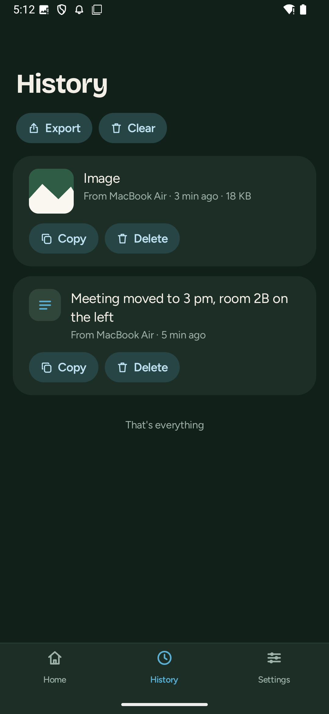

# Clipway

**Copy on your Mac, paste on your phone. And back.**

Clipway is one clipboard for a Mac and an Android phone (GrapheneOS first), plus images and files. What you copy on the Mac is in the phone's clipboard a second later. On the phone, one tap on the "Send to Mac" tile, "Send to Mac" in the text selection menu, or the share menu, and it is on the Mac.

No account. Everything is end-to-end encrypted with a key that only your devices hold, shown once as 12 words. The relay in the middle only passes encrypted texts along, keeps them 24 hours at most for a device that is offline, and anyone can run their own.

**No media on our servers.** Nobody can check what travels end to end encrypted without an account, so the relay refuses to carry pictures or files at all: texts of 64 KB at most, nothing else. Images and files go straight from one of your devices to the other over your local network, encrypted with a key made for that one transfer. Both devices need to be on the same network, and the apps say so plainly when they are not.

| Mac, light | Mac, dark | Android, light | Android, dark |
|---|---|---|---|
|  |  |  |  |

> **Status: 0.3.0, first release.** Both apps work end to end: texts through a relay, images and files directly (tested on a Mac and on the Android emulator, both ways). The reference relay `clip.sidali.dev` is online, texts only. Not yet tested on a physical phone, nor the direct transfer between two real devices on Wi-Fi. Pair nearby (Bluetooth, new in 0.2.0) is checked against the shared vectors without radio, and not yet tried between a real phone and a Mac.

## Principles

- Your data belongs to you.
- No account. No tracking. No ads.
- Nothing leaves your device unless you choose it.
- The code will be published, so anyone can check this.

Audit status: internal review only ([docs/security](docs/security)), no external audit yet.

## What it does

- **Mac to phone, automatic.** Copy a text on the Mac: it lands in the phone's clipboard, with a quiet "Copied from <your Mac>" for 4 seconds. Images too, straight over your network, while the phone is connected. Switches on the Mac: Send automatically, Images too.
- **Phone to Mac, one gesture.** The Quick Settings tile sends the clipboard, "Send to Mac" in the text selection menu sends the selection without copying it, and the share menu sends texts, images and files. On the Mac they go to the clipboard, or to `Downloads/Clipway` for files.
- **Files both ways**, up to 25 MB each, directly between your devices on the same network, never through a server: Send a file or drop on the menu bar icon on the Mac, the share menu on the phone. They land in `Downloads/Clipway`.
- **Secrets stay put.** What password managers mark as concealed or transient on the Mac, and what Android marks as sensitive, is never sent.
- **History** of the last 50 items on each device, encrypted, with an export to a ZIP file that opens without Clipway.
- **Your key, never a burden.** Save the 12 words in your password manager (Android 14+), print a rescue kit, or show them again behind Touch ID or the phone's lock.
- **Erase everything** on either device: the key, the history and the settings, and what waits on the relay (always from the Mac, if you choose from the phone).

## How it works

1. The Mac draws a 128-bit key. The phone next to it gets it over Bluetooth, encrypted, once both screens show the same 4-digit code and you press Pair on both; or it scans the key as a QR code. The key is also 12 words, your backup.
2. Each device derives from it an encryption key and a proof; the relay gets the proof and turns it into a random chain id. It never gets the key.
3. Everything is encrypted on the device (AES-256-GCM) before it leaves: content, file names, device names.
4. The relay passes texts to your other device at once, or keeps them for it up to 24 hours, in memory only.
5. For an image or a file, the sending device listens on your local network for 2 minutes and sends only an encrypted offer through the relay. The other device connects to it, proves it holds the key, and receives the content encrypted with a key made for that transfer. The relay never sees it.
6. The receiving device decrypts, checks size and fingerprint, then writes to its clipboard or to Downloads, and only then tells the relay to forget the item.

The whole protocol, with test vectors shared by the three parts: [docs/PROTOCOL.md](docs/PROTOCOL.md).

## Install

**Android** (Android 12 or later, no Google services needed): install with [Obtainium](https://github.com/ImranR98/Obtainium), which also keeps Clipway up to date. Add an app, paste `https://github.com/sidalidev/clipway`, and install. Obtainium checks the GitHub releases and offers each new version. Or download `clipway-<version>.apk` from the [latest release](https://github.com/sidalidev/clipway/releases/latest) and check it against its `.sha256` file and the signing certificate in [SECURITY.md](SECURITY.md).

**Mac** (macOS 14 or later): download `clipway-mac-<version>.zip` from the [latest release](https://github.com/sidalidev/clipway/releases/latest), unzip it and move `Clipway.app` to Applications. The Mac app does not update itself yet: download the new zip from the releases page.

There is no store release. To build from source instead:

**Mac** (Xcode 26):

```bash
cd mac && ./build.sh          # Release: build/Clipway.app, needs an https:// relay
cd mac && ./build.sh debug    # Debug: also accepts a relay on this Mac (http://127.0.0.1:7710)
```

Move `Clipway.app` to Applications and open it. It lives in the menu bar (no Dock icon). It is signed ad hoc (no Apple Developer ID yet): if macOS says it cannot check the app, open System Settings, Privacy & Security, and choose Open Anyway. After each update, macOS asks once to let the new version read its key in the Keychain.

**Android**:

```bash
export JAVA_HOME=<JDK 21>     # Android Studio's bundled runtime works
cd android && ./gradlew :app:assembleDebug          # app/build/outputs/apk/debug/app-debug.apk
adb install app/build/outputs/apk/debug/app-debug.apk
```

Debug builds also accept a relay on the computer the phone is plugged into (`http://127.0.0.1:7710` through `adb reverse`); release builds accept `https://` only. Release signing reads `~/.clipway/keystore.properties`, never in the repository.

**Pair.** On the Mac: Clipway in the menu bar, Pair a phone. On the phone next to it: Pair nearby, check that both screens show the same code, and press Pair on both (or Scan a code instead, or type the 12 words). Then Save to your password manager, and allow notifications, the tile and background use.

## Try it now with a relay on your Mac

```bash
cd relay && npm ci && HOST=127.0.0.1 PORT=7710 npm start      # the relay, in its own terminal
adb reverse tcp:7710 tcp:7710                                 # the phone, plugged in (or wireless debugging)
```

Open the Debug build of the Mac app, set Settings, Relay to `http://127.0.0.1:7710`, then Pair a phone. On the phone, scan the code: it carries the relay, and the phone asks to confirm it. Keep `adb reverse` in place while you test; without it, the phone waits and reconnects on its own.

## Run your own relay

The relay is one small Node program with one dependency, in a distroless Docker image (no shell, non-root, read-only file system, about 30 MiB of memory at rest):

```bash
docker build -t clipway-relay relay
docker run -d --name clipway-relay --restart unless-stopped \
  -p 127.0.0.1:7710:7710 --read-only --cap-drop ALL --security-opt no-new-privileges \
  -e CLIPWAY_TRUST_PROXY=1 clipway-relay
```

Put a TLS proxy in front (Caddy, nginx and Traefik examples), keep client addresses out of its logs, and allow idle WebSockets of at least 10 minutes. Then set the relay's `https://` address in both apps (Settings, Relay); the pairing code carries it to the phone. Full guide: [relay/README.md](relay/README.md).

## Limits, honestly

- **Android requires one tap to send.** Since Android 10, apps cannot read the clipboard in the background, so the phone sends with the tile, the text selection menu or the share menu. Mac to phone is automatic.
- **One Mac and one phone.** The relay forgets an item once one other device has it. With three devices, one that is offline at that moment misses it.
- **Sizes:** texts up to 64 KB, images and files up to 25 MB.
- **Images and files need the same network.** They go directly between the devices, on the local network, while both are on: a guest Wi-Fi that isolates its clients, a VPN, or the phone on mobile data stops them (texts still go through the relay). The apps say so.
- **What the relay sees:** a random chain id, the time and size of each item, how many of your devices are connected, and your IP address while connected (never logged by the relay; on clip.sidali.dev the web server in front of it keeps IP addresses for 7 days). Not the content, file names or device names.
- **The key is static.** Anyone with your 12 words can read what you send, including what they recorded earlier (no forward secrecy in version 1). If they leak, change the key (Mac: Settings, Change the key).
- **Items waiting to leave the phone are kept in memory.** If Android stops Clipway before the relay has stored them, they stay "Sending" in history and you send them again.
- **No automatic updates in the Mac app yet**, and it is signed ad hoc. On Android, Obtainium installs each new release.
- **Not yet checked on a physical phone:** scanning the code with the camera, the password manager (Proton Pass), and a full day on battery.
- English only.

What Clipway will not do, and why: [NON_GOALS.md](NON_GOALS.md).

## Repository

| Folder | What | License |
|---|---|---|
| [`relay/`](relay) | The relay: Node 22, one dependency (`ws`), Docker | [AGPL-3.0](relay/LICENSE) |
| [`android/`](android) | The Android app: Kotlin, Jetpack Compose, OkHttp | [Apache-2.0](LICENSE) |
| [`mac/`](mac) | The Mac app: Swift 6, AppKit and SwiftUI menu bar app | [Apache-2.0](LICENSE) |
| [`docs/`](docs) | Protocol, vectors, permissions, entitlements, security reviews, design, screenshots | |
| [`fonts/`](fonts) | Bricolage Grotesque and Figtree, with their licenses | [OFL-1.1](fonts/figtree/OFL.txt) |
| [`tools/`](tools) | `gen-vectors.mjs`, which writes `docs/VECTORS.json` | |

Start with [CONTRIBUTING.md](CONTRIBUTING.md) and [ARCHITECTURE.md](ARCHITECTURE.md). Tests: `relay` (node, 74 tests), `android` (JVM, 66), `mac/ClipwayCore` (XCTest, 60), `mac/tools/nearby-vectors.sh`, which plays the phone against the Mac's Pair nearby without Bluetooth (462 checks), and `mac/tools/e2e.sh`, which runs the Mac app against a local relay, direct transfers included (29 checks).

## If the relay goes away

The relay is a single small program anyone can host, and both apps let you set its address. Your history stays on your devices and exports to a ZIP file. The protocol is versioned (`clipway.v1`) and documented, test vectors included.

## Security and privacy

[SECURITY.md](SECURITY.md) (contact@sidali.dev until the repository is public), [PRIVACY.md](PRIVACY.md), [THREAT_MODEL.md](THREAT_MODEL.md), internal reviews in [docs/security](docs/security).

## License

Apps: [Apache-2.0](LICENSE). Relay: [AGPL-3.0](relay/LICENSE).
