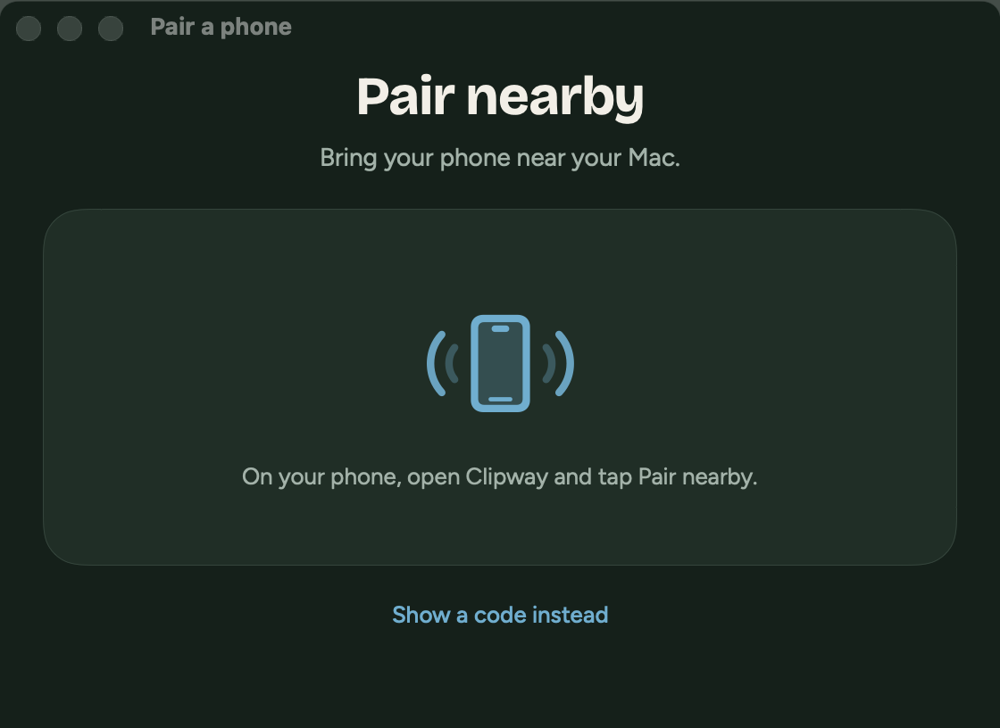
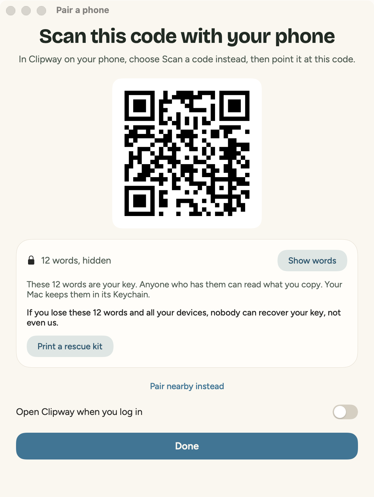

# Clipway for Mac

A menu bar app (no Dock icon), `dev.sidali.clipway`, macOS 14+, Swift 6, AppKit and SwiftUI. App Sandbox, hardened runtime, ad hoc signature. Specification: [../docs/PROTOCOL.md](../docs/PROTOCOL.md), sections 5, 7, 8, 9 and 13 (nearby pairing).

| Light | Dark |
|---|---|
|  |  |
|  |  |

## Build and run

```bash
./build.sh            # Release, universal, into build/Clipway.app: open it with a double click
./build.sh debug      # Debug: also accepts a relay on this Mac (http://127.0.0.1:7710)
swift test --package-path ClipwayCore     # protocol core against docs/VECTORS.json
tools/nearby-vectors.sh   # Pair nearby without Bluetooth: the phone played from the vectors
tools/e2e.sh          # end to end on this Mac against a local relay (see below)
tools/screenshots.sh  # every window, light and dark, into docs/screenshots/mac
```

The relay is `https://clip.sidali.dev` by default (Settings > Relay). Until it is online, use a Debug build and a local relay: `cd ../relay && npm ci && npm start`, then set `http://127.0.0.1:7710` in Settings. Release builds accept `https://` only.

## What it does

- **Mac to phone, automatic.** A timer reads `NSPasteboard.general.changeCount` every 300 ms; the content is read only on a change made by another app. Text (up to 1 MiB) is sent, and images as PNG (up to 25 MiB) when Images too is on. Never sent: content marked `org.nspasteboard.ConcealedType`, `TransientType` or `AutoGeneratedType` (password managers), Finder copies of files, and what the app wrote itself (its own change counts, plus an `org.nspasteboard.source` marker).
- **Phone to Mac.** Texts and images go to the pasteboard (an image as its own type plus TIFF) when they are the newest and less than 10 minutes old; files go to `~/Downloads/Clipway/` under a sanitized name (` 2`, ` 3` on a collision), quarantined. A notification says "Copied from <phone>" (gone after 4 s) or "Received <file> from <phone>" (click shows it in Finder).
- **Send a file** from the menu (Cmd O), or drop files on the menu bar icon. 25 MB each.
- **Pairing.** Pair a phone draws the key (16 random bytes), keeps it in the login Keychain (service `dev.sidali.clipway`, account `chain`, not synchronizable) and opens on Pair nearby; Show a code instead shows the QR code `clipway:<base64url>`.
- **Pair nearby** (section 13). While the window is open, 2 minutes at most, the Mac is a Bluetooth LE peripheral (`CBPeripheralManager`, created when the window opens, so macOS asks for Bluetooth then and never at launch) that advertises the Clipway service UUID and nothing else. The phone next to it writes an ephemeral X25519 key, both screens show the same 4-digit code, and once Pair is pressed on both, the Mac sends the pairing code (the key and the relay) in a packet sealed with AES-256-GCM. One phone per advertisement, new keys for every attempt, nothing kept, no Bluetooth bonding. Also offered in Show the key, after Touch ID or the password. Not offered when the relay address is too long for the packet (about 190 characters). The 12 words appear only after Touch ID or the Mac password (LocalAuthentication) and hide again after a minute; the key windows cannot be captured (`sharingType = .none`). Print a rescue kit prints the words, the code and a page for someone you trust. The phone's hello turns the window into "Connected to <phone>". Join with 12 words lets this Mac join an existing chain.
- **History.** The last 50 items, sent and received, encrypted with AES-256-GCM under a key in the Keychain (account `history-key`): `history.bin` and `items/` in the app's Application Support folder. Click copies back (without sending again) or shows a file; Delete and Clear history with Undo for 5 s; Export writes a ZIP (`history.json`, `items/`) after a warning that it is not encrypted.
- **Settings** (one page): the Mac's name, Send automatically, Images too, Open at login (`SMAppService`), notifications, relay, Show the key, Change the key (erases the old chain on the relay, draws a new key).
- **About**, **What leaves your device**, **Erase everything** (type ERASE): `DELETE /chain` with the proof, then both Keychain items, the history, the settings and the login item are deleted, and the app is back to its first launch. Files in Downloads stay.

## Code map

| Folder | What |
|---|---|
| `ClipwayCore/` | Swift package, CryptoKit and Foundation only: keys and envelopes (`Crypto.swift`, `ChainKeys.swift`), item heads serialized byte for byte like the reference (`Head.swift`), items and chunks (`ItemCodec.swift`), relay frames (`Frames.swift`), the client protocol state machine without the socket (`SyncEngine.swift`), receive rules and pasteboard filtering (`Rules.swift`), file names and relay addresses (`FileNames.swift`), the encrypted history and its ZIP export (`History.swift`, `ZipWriter.swift`). Pair nearby without radio: X25519, keys, code and packet (`Nearby.swift`), the Mac's answer to every Bluetooth request (`NearbySession.swift`), the clock and write batches (`NearbyHost.swift`), and the command line check (`NearbyReplay.swift`). 43 XCTest tests. |
| `Clipway/` | The app: `AppModel.swift` (state and actions), `RelayClient.swift` (URLSessionWebSocketTask, subprotocols `clipway.v1` and `clipway.p.<P>`, reconnection, 60 s ping), `NearbyPairing.swift` (the CoreBluetooth peripheral, a thin shell around `NearbyHost`), `Pasteboard.swift`, `StatusItem.swift` (menu and drop target), `WindowRouter.swift`, `Views/` (`NearbyViews.swift`: the Pair nearby panel and the code), `RescueKit.swift`, `System.swift` (Keychain, QR code, Touch ID, login item, signature, notifications). |
| `Clipway/Tokens.swift` | Spacing, radii, type, motion and colors. Colors are the system's (accent and semantic colors, light and dark); views use no literal. |
| `tools/` | `e2e.sh`, `nearby-vectors.sh`, `screenshots.sh`, `make-icon.swift` (the icon, drawn from paths). |

`project.yml` is the source of the Xcode project (`xcodegen generate`); the generated `Clipway.xcodeproj` is committed so that `xcodebuild` works without XcodeGen. `CHANGELOG.md` and `PRIVACY.md` from the repository root are copied into the app for What's new and Privacy policy.

## End-to-end test

`tools/e2e.sh [port]` starts a relay on port 7711 (or uses the one that answers), draws a chain with `relay/tools/client.mjs` (which plays the phone), and drives the Debug build through launch arguments that exist only in Debug builds (`--debug-relay`, `--debug-join`, `--debug-send-file`, `--debug-erase`, `--debug-menu`; they call the same code as the screens). It checks 23 things with the real pasteboard, Keychain, Downloads folder and relay: text both ways and Delivered, no echo, concealed content kept, images both ways, 3 MB files both ways in 4 parts with the same SHA-256, the collision name, the quarantine attribute, reconnection after a restart, the menu and the history read back after it, an erase from the phone (the Mac stops, and stays stopped after a restart), and Erase everything (relay confirmation, Keychain and history gone). It overwrites the pasteboard (text is restored at the end).

Two more Debug-only arguments drive a run with a real phone or emulator: `--debug-pair` draws a key as Pair a phone does and prints the words of that throwaway chain (so a test can type them on the phone), and `--debug-send-path PATH` sends a file from Downloads as Send a file does.

## Pair nearby without Bluetooth

The Android emulator has no Bluetooth and CI has no radio, so `tools/nearby-vectors.sh` runs the Debug build with `--debug-nearby-vectors` (the vectors arrive on the standard input, which the sandbox allows). It checks the derivations, the packets and the negative cases, replays the 8 scripted sessions of `docs/VECTORS.json` against the Mac's state machine, then plays the phone against the same code the CoreBluetooth shell calls: commitment read before the key, the code on both sides, Pair in either order, the packet read in pieces as with ATT Read Blob (MTU 185 and 35), the 120 second limit, the 10 seconds of grace and one answer per write batch. 462 checks; exit code 0 when all pass. `swift test` runs the same check. The real exchange with a Pixel is tested by hand (docs/PROTOCOL.md, 13.10).

## Notes

- **Ad hoc signature and the Keychain.** The Keychain ties its items to the app's code signature, and an ad hoc signature changes with every build: after an update, macOS asks once to let the new version read the key ("Always Allow"). A Developer ID (or any stable signing certificate) removes the prompt.
- **Pasteboard privacy.** On macOS 26 the app reads the pasteboard only after a change made by another app; reading types (to skip secrets) never reads content.
- **Screenshots** are rendered by the app itself (`--snapshots`, Debug only) with sample data, so they never show a real key or real history. The menu itself is a system menu and is not in them.
